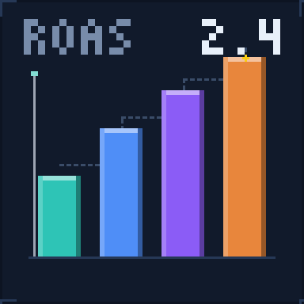
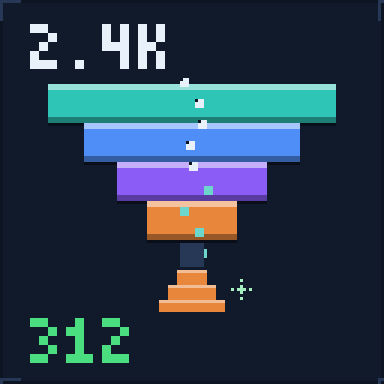
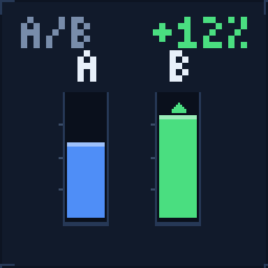
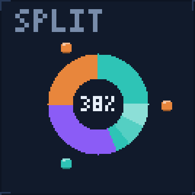
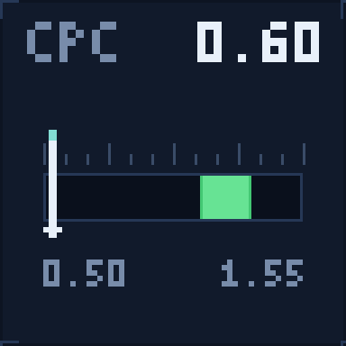
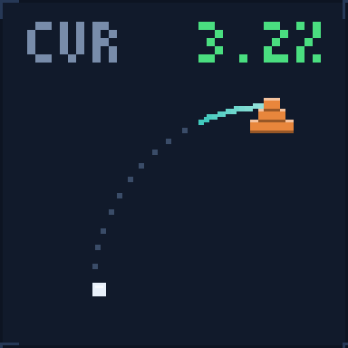
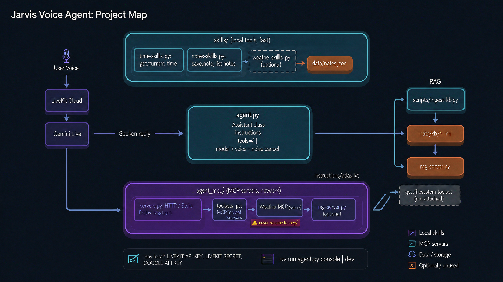

<p align="center">
  
</p>

<h1 align="center">Marketing AI Agent</h1>

<p align="center">
  <em>A voice-first analyst for marketers. Ask a question about spend, pipeline or rankings — get an answer with the numbers behind it, not another dashboard.</em>
</p>

<p align="center">
  
  
  
  
  
</p>

> **Status — early.** The voice loop, the local-skill pattern and the MCP-toolset pattern all run today (with demo skills and the LiveKit docs server attached). The marketing skills and the ad-platform connectors described below are the build target, not shipped features. Every claim in this file is marked **wired** or **planned**.

---

## Why voice

Marketing decisions get made in conversation — on a call, in a standup, halfway through a budget review. The tooling, though, lives in a dozen dashboards that nobody opens mid-sentence.

This agent sits where the question is asked. It pulls the numbers through MCP connectors, does the arithmetic in deterministic local skills, and answers out loud in a few sentences. The dashboard stays the source of truth; the agent is the thing you can ask.

---

## The questions it is built to answer

| | Skill | What it does | Ask it |
|---|---|---|---|
|  | **Performance reporting** | Blended ROAS, CPM / CPC / CPA by channel, week-over-week deltas, and a plain read on what moved | *"How did paid perform last week?"* |
|  | **Funnel analysis** | Impression → click → landing → lead → opportunity → revenue, and the step that is actually leaking | *"Where are we losing people before signup?"* |
|  | **A/B testing** | Test status, sample size, what is genuinely ahead, and whether calling it now is safe | *"Is the new pricing page test done?"* |
|  | **Budget allocation** | Reallocation across channels against a target or margin constraint, with expected lift and the downside | *"Move 20k from display into search — what happens?"* |
|  | **Bid management** | CPC / CPA drift outside the target band, and which campaigns need a bid change | *"Why is CPC creeping up in Germany?"* |
|  | **Conversion optimisation** | Landing pages, forms and campaigns ranked by revenue at stake, not by raw CR | *"What should we fix first?"* |
|  | **Organic: SEO, AEO, GEO** | Keyword and SERP movement, plus whether the brand shows up when an AI answers | *"Do we appear when someone asks an AI for the best CRM?"* |

---

## Where the numbers come from

Every external system is an MCP server, so the agent's reach grows by configuration rather than by rewriting the agent.

| Connector | What it unlocks | Status |
|---|---|---|
| **Meta Ads** (Marketing API) | Spend, delivery and ROAS at campaign / ad set / ad level | planned |
| **Google Ads** (Ads API) | Search and Performance Max spend, quality score, auction insights | planned |
| **LinkedIn Ads** | B2B campaign spend and lead-gen form fills | planned |
| **SEO suite** (Ahrefs / Semrush / Moz) | Rankings, backlinks, keyword gaps, SERP features | planned |
| **Looker Studio** | The reporting layer the team already trusts — same numbers, spoken | planned |
| **Social platforms** | Organic post performance and inbound comment signals | planned |
| **LiveKit Docs** | Setup and API questions about the agent runtime itself | **wired** |

Connectors are registered in `agent_mcp/` and injected as toolsets. Nothing about the agent changes when one is added.

---

## Architecture

<p align="center">
  
</p>

Two kinds of tool land in the same `tools=[...]` list and look identical to the model. They are not identical in behaviour:

- **`skills/` — local, in-process, fast.** A `@function_tool` that runs Python in the worker. No network hop, no auth, fully deterministic. This is where the maths belongs: ROAS blends, funnel ratios, significance tests, allocation scenarios.
- **`agent_mcp/` — remote, networked, slow.** An `MCPToolset` wrapping an HTTP or stdio server. Rate-limited, token-authenticated, and the part that breaks when a platform has an incident. This is where fetching belongs.

The rule that keeps the numbers honest: **fetch through MCP, compute in a skill, and never let the language model do arithmetic that someone will spend money on.**

The voice path is speech-to-speech on `google/gemini-3.8-live` through LiveKit Inference — no separate STT, TTS or VAD stage — with `ai_coustics` noise cancellation on the input so a noisy office doesn't become a bad transcript.

A question travels like this:

```text
"Why did CAC jump in Germany last week?"
  → Meta Ads + Google Ads MCP   spend, clicks, conversions by market
  → funnel_analysis skill       which step moved, by how much
  → bid_management skill        CPC drift vs the target band
  → spoken answer, ~4 sentences, with the figures used
```

---

## Quickstart

**Requirements:** Python 3.12+, [uv](https://docs.astral.sh/uv/), a LiveKit Cloud project.

```bash
uv sync                     # install dependencies from pyproject.toml + uv.lock
uv run agent.py console     # talk to the agent in your terminal, no room needed
uv run agent.py dev         # register the worker "my-agent" against LiveKit Cloud
```

Prewarm the plugin models (and the noise filter) before a demo:

```bash
uv run agent.py download-files
```

### Configuration

Secrets live in **`.env.local`** — not `.env`, which nothing reads. It is loaded explicitly in `agent.py`.

```ini
LIVEKIT_URL=wss://your-project.livekit.cloud
LIVEKIT_API_KEY=...
LIVEKIT_API_SECRET=...
GOOGLE_API_KEY=...          # optional: unused on the LiveKit Inference path
```

Gemini Live runs through LiveKit Inference, so it authenticates with the LiveKit key pair. `GOOGLE_API_KEY` sitting there unused is expected, not a misconfiguration.

---

## Project layout

```text
agent.py                    Entrypoint: AgentServer, Assistant (instructions + tools), session setup
skills/                     Local in-process tools — fast, deterministic, no network
  time_skills.py            get_current_time
  notes_skills.py           save_note, list_notes           → data/notes.json
  web_skills.py             get_webpage_title
agent_mcp/                  MCP server wrappers — networked, authenticated, rate-limited
  servers.py                Server configs: remote HTTP (+headers) and local stdio
  toolsets.py               Wraps servers into MCPToolset objects with tool whitelists
data/                       Runtime data (notes.json; a natural home for cached pulls)
assets/                     README art — generated pixel GIFs and the architecture map
scripts/
  generate_readme_gifs.py   Rebuilds every GIF in assets/ from code
.env.local                  All secrets (git-ignored)
```

---

## Adding a skill

A skill is a file in `skills/` with one or more `@function_tool` functions. It runs in-process, so keep it to data that has already been fetched.

```python
# skills/performance_report.py
import json
from pathlib import Path
from livekit.agents import function_tool
from livekit.agents.llm import ToolError

CACHE = Path("data/last_pull.json")


@function_tool
async def summarise_performance(window: str = "7d") -> str:
    """Summarise paid performance for a window.

    Args:
        window: Reporting window, e.g. '7d', '14d', 'mtd'.
    """
    if not CACHE.exists():
        raise ToolError("No campaign data pulled yet. Run a connector first.")

    rows = json.loads(CACHE.read_text())["campaigns"]
    spend = sum(r["spend"] for r in rows)
    revenue = sum(r["revenue"] for r in rows)
    if spend == 0:
        raise ToolError("Spend is zero for this window — nothing to attribute.")

    roas = revenue / spend
    worst = min(rows, key=lambda r: r["revenue"] / max(r["spend"], 1))
    return (
        f"{window}: spend {spend:,.0f}, revenue {revenue:,.0f}, blended ROAS {roas:.2f}. "
        f"Weakest campaign is {worst['name']} at "
        f"{worst['revenue'] / max(worst['spend'], 1):.2f} ROAS."
    )
```

Then add it to the tool list in `agent.py`:

```python
from skills.performance_report import summarise_performance

tools=[get_current_time, save_note, list_notes, get_webpage_title,
       summarise_performance, get_livekit_docs_toolset()]
```

Write the docstring as if the model is the reader — it is. That string is the tool's entire interface.

## Adding a connector

```python
# agent_mcp/servers.py
import os
from livekit.agents import mcp


def get_meta_ads_server() -> mcp.MCPServerHTTP:
    """Meta Ads connector — read-only marketing insights."""
    return mcp.MCPServerHTTP(
        url=os.environ["META_ADS_MCP_URL"],
        transport_type="streamable_http",
        headers={"Authorization": f"Bearer {os.environ['META_ADS_TOKEN']}"},
        allowed_tools=["get_insights", "list_campaigns", "get_adset_breakdown"],
    )
```

```python
# agent_mcp/toolsets.py
def get_meta_ads_toolset() -> mcp.MCPToolset:
    return mcp.MCPToolset(id="meta_ads", mcp_server=get_meta_ads_server())
```

Then pass `get_meta_ads_toolset()` in `agent.py` alongside the others.

Whitelist with `allowed_tools` and keep it to reads. A production voice agent with write access to spend is a different product with a different approval flow — see below.

---

## Guardrails

- **Read-only by default.** Connector tokens are scoped to read. No skill mutates a live campaign.
- **Changes are proposed, then confirmed.** Budget and bid moves come back as a dry-run diff, and only apply after an explicit spoken yes in a separate turn.
- **Every write is logged.** Who asked, what changed, before and after — append-only, in `data/`.
- **Numbers come from code.** The model chooses which skill to call and how to explain it. It does not compute ROAS in its head.
- **Least data in the prompt.** Aggregates in, PII out. No customer records are read aloud.

---

## Gotchas that have already bitten

- **Never rename `agent_mcp/` back to `mcp/`.** It shadows the PyPI `mcp` SDK and `livekit.agents` fails from *inside* site-packages, pointing at the wrong file.
- **`.env.local`, not `.env`.** Only the former is loaded.
- **`get_current_time` needs `tzdata` on Windows**, otherwise `ZoneInfo` raises. The dependency is already in `pyproject.toml`.
- **stdio MCP servers need a longer timeout.** The 5s default loses to `npx` cold starts; use `client_session_timeout_seconds=60`.
- **No pip in `.venv`.** Use `uv add` / `uv sync`; `requirements.txt` is stale and unread.

---

## Roadmap

- [x] Speech-to-speech voice loop on Gemini Live
- [x] Local skill pattern (`@function_tool`) and MCP toolset pattern
- [x] Docs connector wired end to end
- [ ] Meta Ads and Google Ads read connectors
- [ ] Performance + funnel skills running against real pulls
- [ ] SEO / AEO / GEO skill over a rankings connector
- [ ] Budget and bid changes behind a propose-confirm-apply flow
- [ ] Turn-level tests with mocked toolsets

---

## Notes

- Assistant instructions are spoken aloud — no markdown, asterisks or emoji in replies.
- `scripts/generate_readme_gifs.py` rebuilds every animation in `assets/` from code: `uv run --with pillow python scripts/generate_readme_gifs.py`.
- Typecheck with `uvx --from pyright pyright --pythonpath .venv/Scripts/python.exe .`

## References

- [LiveKit Agents](https://docs.livekit.io/agents/) · [MCP](https://modelcontextprotocol.io/) · [Google Ads API](https://developers.google.com/google-ads/api/docs/start) · [Meta Marketing API](https://developers.facebook.com/docs/marketing-apis/) · [LinkedIn Ads API](https://learn.microsoft.com/en-us/linkedin/marketing/)
